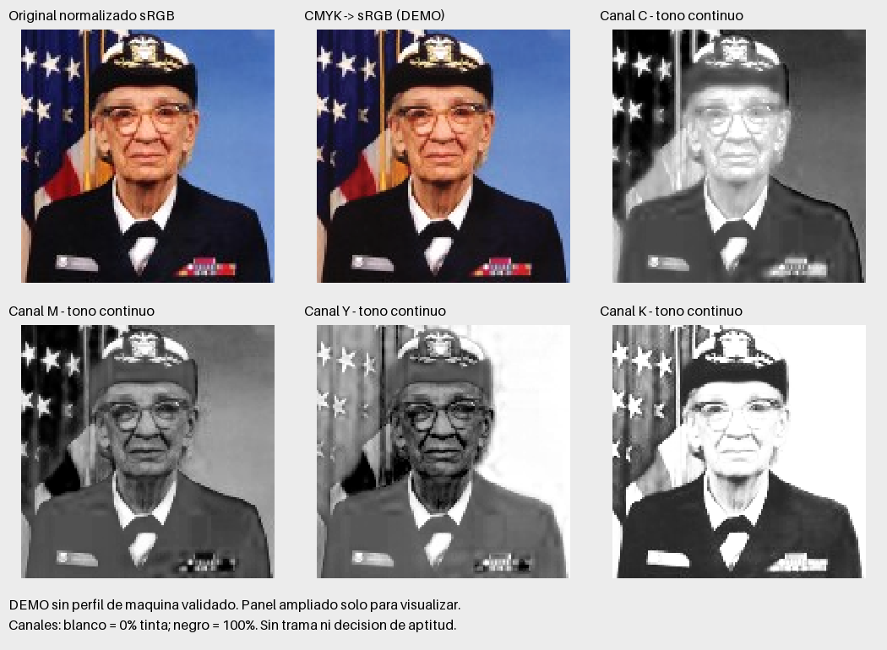
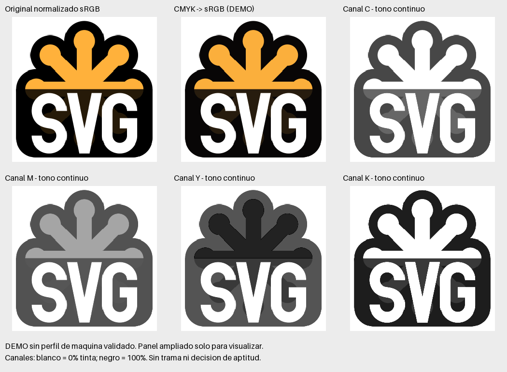

# M2 — separar color para revisar las tintas

Aporte de Ignacio / TrainPulga con asistencia de Codex. Reutilicé la conversión ICC del prototipo (commit histórico M2 c5c98cf) y la adapté al paquete `flexo_img.color`. Agregué la fórmula normalizada de #4 y pruebas de primarios. Ambas técnicas están diferenciadas: una fórmula didáctica no sustituye un perfil ICC de máquina.

## Qué hice y para qué sirve

Tomé la foto real y el logo de colores planos de M1. Los convertí de RGB a CMYK con LittleCMS vía Pillow y exporté los cuatro canales. Permite ver qué parte de cada tinta se asigna al diseño antes de decidir fabricar una plancha. No se imprimió ni grabó una plancha.

## Qué mostrar en el coloquio

Las seis casillas muestran original normalizado, preview CMYK→sRGB y C/M/Y/K. El panel se escala solo para visualizar, no agrega detalle. En `canal_*_gris_DEMO.png`, blanco=sin tinta y negro=máxima tinta. En `canal_*_cobertura_DEMO.png`, el dato de cobertura es 0=sin tinta y 255=máxima: visualmente estos bytes se ven al revés en un visor PNG normal. Esa distinción resuelve la ambigüedad de #4 sin asumir polaridad de exposición del RIP. No son archivos tramados ni planchas de producción.

## Perfiles y supuestos

Entradas de esta demo sin ICC: asumí sRGB explícitamente con `--asumir-srgb`. Si el original trae ICC RGB válido se usa, y uno corrupto no se ignora. Perfiles oficiales de Artifex/GhostPDL, revisión `98f6c50f39531b7a3de9c8082659f8cad524f0d3`: `default_rgb.icc` (sRGB) y `default_cmyk.icc` (CMYK SWOP). Orígenes exactos, hashes, descripciones y copyright en `perfiles-icc/origenes.json`; LICENSE y COPYING de Artifex adjuntos. Revisar obligaciones antes de distribución comercial. SWOP no está validado para el taller, su plancha o sustrato: todas las salidas son DEMO.

Intento relativo colorimétrico con compensación de punto negro. Preview es reconversión a sRGB para pantalla. No se sustituye una prueba física ni se mide ΔE con instrumento sobre papel.

## Qué probé y qué obtuve

26 pruebas de color aprobadas: blanco/negro/gris/primarios, fórmula sin división por cero, modos y límites, ICC válido/ausente/incompatible/corrupto, transparencia, orientación, no sobrescritura, conservación de entrada, inversión y hashes. Rojo puro por fórmula: C=0, M=255, Y=255, K=0. ICC puede separar distinto y por eso no se le exige reproducir esa fórmula.

Valores observados de esta ejecución sobre todos los píxeles:

| Muestra | ΔE76 medio de reconversión sRGB D65 | P95 | Máximo |
|---|---:|---:|---:|
| Foto | 1,4732 | 3,1914 | 11,4533 |
| Logo | 1,0084 | 1,8469 | 3,0789 |

Ejemplo del logo: RGB (255,177,59) vuelve como (251,175,60), CMYK de 8 bits (0,90,221,0). El cambio se calcula; no implica aprobación de color para impresión. `muestras_color.csv` e `informe_M2.json` permiten revisar píxeles, cobertura nominal y diferencias. Foto original 128×128: no demuestra calidad de impresión grande.

Ruff, formato y el conjunto de 78 pruebas pasaron; cobertura y ejecución limpia en [validacion-diciembre.md](validacion-diciembre.md). Pendiente: ICC de máquina, RIP, sustrato, tintas, perfil de entrada real y prueba física. Tramado y aptitud se integran/validan en febrero.
