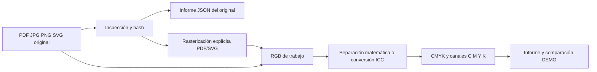

# SRS — flexo-img

Ignacio / TrainPulga con asistencia de Codex. Fuentes: [#1](https://github.com/datamaq-automation/flexo-img/issues/1), [#2 producto](https://github.com/datamaq-automation/flexo-img/issues/2), [#3 ingesta](https://github.com/datamaq-automation/flexo-img/issues/3), [#4 color](https://github.com/datamaq-automation/flexo-img/issues/4). Revisadas completas, sin comentarios adicionales en esta consulta.

## Objetivo, usuarios y alcance
El operador de preprensa inspecciona originales antes de fabricar una plancha. El responsable técnico decide aceptación y el diseñador corrige problemas. Programa CLI local: recibe rutas y entrega archivos; no conecta con producción ni fabrica planchas.

Diciembre: diseño de producto/arquitectura, ingesta y separación. Febrero: integrar tramado y reglas de aptitud, verificar con muestras y parámetros del taller. No se emite APTO/NO APTO industrial en diciembre. Los experimentos de tramado/evaluación anteriores permanecen en el ZIP/bundle original fuera de esta rama.

## Recorrido de un archivo y arquitectura

`src/flexo_img/inspeccion.py` lee/describe/rasteriza; `color.py` separa/convierte/exporta. Funciones comprobables, tests offline, dependencias de procesamiento sin servidor HTTP. Informes JSON/CSV para evidencia y Markdown para explicar resultados.

## Requisitos funcionales y aceptación
| ID | El sistema DEBE… | Cómo se comprueba |
|---|---|---|
| RF-01 | inspeccionar PDF, JPG/JPEG, PNG y SVG al recibir rutas locales, sin alterar originales y registrando SHA-256 | tests/test_inspeccion.py: formatos reales/sintéticos, hashes, entradas inválidas |
| RF-02 | informar dimensiones, espacio/modo conocido, resolución disponible y contenido raster/vector/texto/mixto cuando corresponda; indicar desconocidos | pruebas de JPEG RGB/CMYK/L, PNG sin DPI, PDF con imagen colocada y SVG; vectores sin DPI global inventado |
| RF-03 | separar datos originales de PPP y tamaño elegidos cuando rasteriza PDF/SVG | pruebas a varios PPP, unidades/viewBox y giro; SVG relativo requiere tamaño elegido explícitamente |
| RF-04 | registrar errores al recibir archivos rotos o recursos SVG activos/externos | pruebas de corruptos, scripts/entidades y referencias externas; CLI conserva otros resultados y sale no cero |
| RF-05 | generar C/M/Y/K de 8 bits con la fórmula normalizada de #4 al invocar separar_cuatricromia | tests/test_color.py: primarios, blanco, negro y gris; evitar división por cero en negro pleno; método didáctico sin ICC |
| RF-06 | usar perfiles explícitos y exigir consentimiento para asumir sRGB cuando convierte RGB sin ICC | tests ICC ausente, incrustado, corrupto, incompatible, transparencia y orientación |
| RF-07 | exportar TIFF CMYK con ICC, canales grises, preview, CSV e informe cuando termina la conversión | pruebas de píxeles, inversión, perfiles/hashes y demo sobre foto/logo |
| RF-08 | distinguir cobertura cruda de apariencia de pantalla al exportar canales | cobertura 0=sin tinta/255=máxima y vista invertida 255 blanco=sin tinta/0 negro=máxima; pruebas de inversión |
| RF-09 | rechazar salidas de color existentes y entradas fuera de límites al procesar | tests de recursos y no sobrescritura; límites de seguridad, no umbrales de imprenta |

PDF: espacios de imágenes embebidas disponibles; no se auditan todos los espacios vectoriales, OutputIntent o tintas especiales. SVG: interpretación CSS/sRGB indicada, no caracterización colorimétrica completa. No se clasifica automáticamente foto versus logo.

## Requisitos no funcionales
- Calidad: Pytest con cobertura medida y mínimo de entrega 85 %, Ruff y formato (decisión de este aporte, no umbral de máquina). Pruebas sin red ni envíos; comandos del README verificados desde copia limpia.
- Integridad/recursos: entradas sin cambios, hashes y procedencia; 25 MiB por entrada, 20 páginas y 20 millones de píxeles en inspección/render; color hasta 2 millones de píxeles. No prometen procesar originales industriales arbitrarios.
- Portabilidad: Python 3.10 o superior. La suite se comprobó en Linux con 3.10.22 y 3.12.14. Windows nativo queda sin verificar.
- Rendimiento: objetivo de procesar un archivo de hasta 10 MB en menos de 5 segundos. El [ensayo reproducible](informes/validacion-diciembre.md) registra tamaño, equipo, operación y tres tiempos. El resultado depende también de la cantidad de páginas y píxeles.
- Trazabilidad: commits por avance, informes con pruebas y supuestos, salidas DEMO. Medición numérica de color no equivale a prueba impresa.

## Casos de uso
**CU-01, archivo legible (diciembre):** operador elige original; inspecciona; para vector elige rasterización; convierte/separa y revisa canales. Resultado: evidencia técnica DEMO, no aprobación industrial.

**CU-02, inválido o incompleto (diciembre):** archivo roto da error; falta de DPI queda desconocida; SVG relativo requiere tamaño; RGB sin ICC requiere asumir sRGB expresamente o aportar un original caracterizado. Se puede pedir corrección al diseñador sin fabricar.

**CU-03, aceptación/rechazo (febrero):** con tamaño final, LPI y parámetros validados, contrastar resolución efectiva inicial >=2×LPI, cobertura y líneas; justificar APTO/NO APTO. Si faltan parámetros, aptitud no determinada. El ejemplo 72 PPP a 120 LPI incumple 240 PPP, pero no define todas las condiciones de fabricación. Requiere integración y nuevos ensayos.

## Decisiones y parámetros pendientes
1. #4 nombra 0 blanco/sin tinta y 255 negro/tinta: en PNG L estándar 0 es negro y 255 blanco. Se entregan cobertura cruda y vista invertida claramente etiquetadas; confirmar qué formato/polaridad espera el RIP.
2. Fórmula matemática e ICC no producen necesariamente los mismos valores. Se prueban por separado; SWOP no es un perfil validado de la máquina flexográfica.
3. Los ejemplos de #2 (aviso <200 DPI, 65–150 LPI, 10 MB/5 s) no son umbrales de producción confirmados. Diciembre informa datos; avisos/aptitud por tamaño final y proceso se completan en febrero. No confundir DPI de metadatos con resolución efectiva de impresión.
4. Confirmar si el RIP hace el tramado, formato/resolución final, ángulos, polaridad de exposición, espesor/tipo de plancha, sustrato, tintas, ICC, ganancia de punto, límite TAC, punto mínimo/máximo y líneas positivas/negativas mínimas. Faltan muestra autorizada y prueba física.
5. El PR referencia #1 con `Refs #1`, sin cerrarla. Propone `Closes #2`, `Closes #3` y `Closes #4` según la pauta docente: esas sub-issues solo se cerrarían si el profesor fusiona la entrega. La épica pide PRs feature/ hacia main; por pedido del alumno se agrupa diciembre en un PR con commits identificables.
6. Leídos también [#5](https://github.com/datamaq-automation/flexo-img/issues/5) y [#6](https://github.com/datamaq-automation/flexo-img/issues/6), sin comentarios adicionales: febrero requiere `halftone.py`, `ValidadorFotopolimero` en `validator.py`, salida binaria y reportes con parámetros/tolerancias. #6 fija como criterios pedagógicos iniciales DPI efectivo >=2×LPI, TAC máximo 300 % configurable por sustrato y alerta de puntos del 2–3 %. Se incorporan a la planificación, pero no se afirma que esos parámetros estén validados para la máquina del profesor. Se requieren ensayos de APTO, baja resolución y exceso de TAC; completar punto/líneas críticas y prueba física. El ensayo previo de 30/60 LPI del respaldo no reemplaza la futura validación con lineaturas del proceso.
